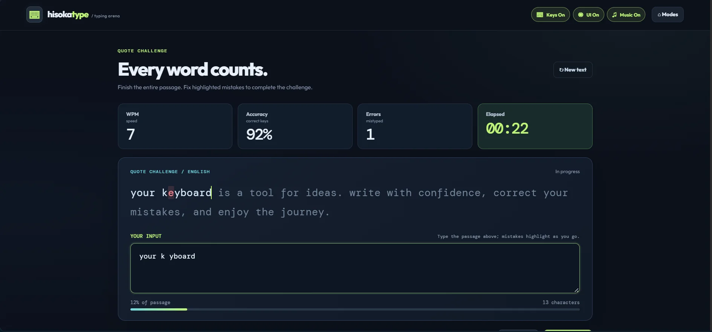

# ⌨️ HisokaType — Typing Arena

A responsive typing speed game built in **vanilla HTML, CSS and JavaScript**, with three distinct ways to practice. The project keeps its original static architecture and does not require a backend, a framework, or an installation step.

## Three game modes

| Mode | Goal | End condition |
| --- | --- | --- |
| **Time Attack** | Type the displayed text as fast and accurately as possible | Selected **15 / 30 / 60 / 120 seconds**, starting with the first typed character |
| **Quote Challenge** | Type the complete passage, correcting any mistakes | The text matches the passage **exactly**, or the player chooses to finish early |
| **Zen Practice** | Write freely without a target text or time limit | The player chooses **Finish practice** |

Choose **English** or **Français** before playing. All sample texts are included in the application; no API or network connection is required for the game logic.

## Features

- Minimal, dark typing UI with dedicated **Setup**, **Typing**, and **Results** screens.
- Mobile-responsive mode cards, statistics, and touch-friendly controls. A real `textarea` supports onscreen keyboards.
- Live character highlighting: **correct**, **incorrect**, **upcoming**, and current cursor.
- Timer starts **on first text input**, not as soon as the challenge screen opens.
- Backspace and editing update the live text evaluation correctly.
- Live **net-style WPM**, **raw WPM**, **accuracy**, elapsed/remaining time, and error indicators.
- Session summary with performance feedback, personal best per game-mode/language/duration, and six recent results on the home screen.
- Best scores and up to 25 recent sessions are stored in browser `localStorage` **without storing typed content**.
- **Fair personal bests:** timed runs must finish, Quote Challenge must be completed (at least 3 seconds), and Zen practice must last at least 30 seconds with 40 or more characters. Short or manually stopped sessions still appear in history.
- Restart current test, choose a new passage, switch modes, or manually finish without disruptive browser dialogs.
- Pasting and dropping text into the typing field are blocked during tests.
- **Keyboard-friendly prompts:** Time Attack and Quote Challenge display all practice text in lowercase. French accents and hard-to-type typographic characters are simplified (for example, `réveille` → `reveille`, `Écris` → `ecris`, `cœur` → `coeur`) so standard keyboards can complete every passage. Uppercase input is still accepted as lowercase.
- **Three independent sound controls** in the header: `Keys` for soft keypress/correction sounds, `UI` for button clicks, and `Music` for an original, quiet **piano-style melody** while a test is open, with a soft attack, decaying notes, and low volume. Each can be muted separately, even on mobile.
- Audio preferences persist in `localStorage`; background music stops on the results/setup screens, when the page is hidden, and when leaving the page. Music and effects are generated locally using the Web Audio API and require a user interaction to unlock playback.
- No runtime image or audio dependencies. The gameplay screenshot documents the interface in this README; the legacy GIF remains in the repository but is not loaded by the site.

## Understanding the metrics

The displayed WPM uses the **five-character standard** (including spaces):

```
WPM = (currently correct characters / 5) / elapsed minutes
Raw WPM = (currently entered characters / 5) / elapsed minutes
Accuracy = correctly matching characters / entered characters × 100
```

- For Time Attack and Quote Challenge, a character is currently correct if it matches the reference at the same position **regardless of uppercase/lowercase**. **Accuracy is updated when you correct text with Backspace**.
- Live **Errors** counts incorrect characters still present in the current text.
- The result's **Mistyped keys** counts incorrect characters when they were entered, including mistakes corrected later. This value is intentionally different from the live uncorrected error count.
- Zen Practice has no target passage, so its WPM is based on the number of entered characters and its accuracy is shown as 100% by definition.
- The game calculates elapsed time with `performance.now()`, rather than assuming the interval timer ticks at precisely one-second intervals.
- Results from very short sessions are indicative; use longer timed sessions for a meaningful comparison.

## Run locally

Clone this repository and open `index.html` in a modern browser. For a local web server:

```bash
python -m http.server 8000
```

Then visit http://localhost:8000.

## GitHub Pages

The site is a static app, so it can be deployed with GitHub Pages from the root of the default branch, when Pages is enabled in the repository settings.

Expected URL:

https://hisokabk.github.io/brief-4-DOM-Gamification--Game-2/

## Existing files

- `index.html` — the three-screen UI, game modes and statistics.
- `style.css` — responsive dark UI, highlighting and mobile styles.
- `index.js` — prompts, timers, typing evaluation, storage, results and interactions.
- `image/hisokatype-gameplay.webp` — screenshot shown at the top of this README.
- `image/` — also contains the legacy GIF, retained but not used in the UI.

The gameplay screenshot is a documentation-only asset and is not loaded by the app.
